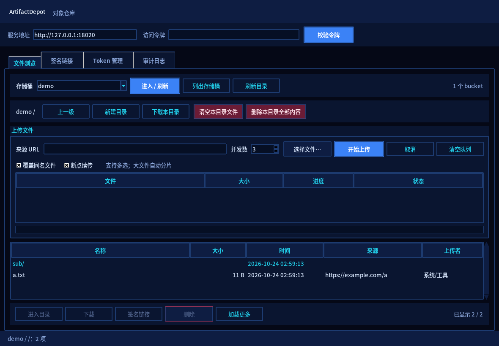

# ArtifactDepot 桌面客户端

深蓝主题的桌面客户端，覆盖当前 Web 端功能：文件浏览、上传、下载（分块并发）、签名链接、Token 管理、审计。



## 功能

**文件浏览**
- 列出/进入 bucket，目录导航，分页加载更多；
- 上传：多选文件、拖拽文件到窗口、来源 URL、文件并发数、大文件自动分片、失败重试、断点续传；
- 下载：单个文件自动分块并发（分块大小与并发数默认取服务端 `data.download`，可在动作栏「下载并发」调整 1–16）；显示已下载字节、百分比与实时速度；可随时「取消下载」；
- 目录下载：「下载本目录」在目录只有 1 个文件时直接下载，否则由服务端流式打包 ZIP；ZIP 无 Content-Length，保持单流，不做分块并发；
- 新建目录；删除文件/空目录；
- 批量删除：「清空本目录文件」/「删除本目录全部内容」，先预览数量与大小，输入目录名确认；
- 签名链接：为文件生成按时效/按次数/永久链接，复制、查看、作废。

**签名链接**

查看创建者、文件、类型、剩余、创建时间、状态、链接；复制或作废。

**Token 管理**

- 查询注册表、显示明文（管理员）、移除 token；
- 从 DataHub 同步、重新加载配置；
- 按权限点生成 Token：角色预设、过期时间、说明、Bucket 白名单（勾选/手填）、路径前缀白名单、全选/全不选/仅读/仅写、生效范围预览；
- 生成结果仅展示一次，可复制。

**审计**

按 bucket、key、操作者、起始时间查询审计记录（时间、动作、bucket、key、操作者、IP、代理 IP、大小）。

## 下载（分块并发）

- **分块并发**：客户端先 `HEAD /api/objects/download` 探测文件大小、`Accept-Ranges`、ETag 与文件名；文件大于分块且服务端支持 Range 时，按区间并发 `GET`（`Range: bytes=a-b`，期望 206 + `Content-Range`），各分片写入 `.part` 文件对应偏移，完成后校验大小并 `os.replace` 为最终文件。分块大小与并发数取自 `GET /api/auth/permissions` 的 `data.download`（服务端夹紧 1–64MiB / 1–16 / 60s–7d）；服务端不可用时回退 8MiB / 4 路 / 1h。
- **回退单流**：小文件（≤ 分块）、服务端不支持 `Accept-Ranges`、`HEAD` 不可用、`concurrency=1`、目录 ZIP、签名链接，均沿用原来的单流下载（`.part` + `os.replace`）。
- **失败重试**：每个分片失败最多重试 3 次（指数退避）；只对网络错误/超时/5xx/429 重试，4xx（含 416）直接报错。
- **取消**：下载中可点「取消下载」，客户端尽快停止各分片线程、删除 `.part` 并复位界面。
- **完整性校验**：服务端 ETag 是对象 SHA-256 时，并发下载完成后会计算本地 SHA-256 比对，不一致会报错并清理临时文件。
- **进度与速度**：状态栏显示「已下载 x / y（p%） · 速度 z/s」；进度回调按 ≥150ms 合并刷新，避免刷屏。ZIP 流总大小未知，只显示已下载字节与速度。
- **签名链接慎用**：签名链接按次数计数，客户端不会对签名链接做 `HEAD` 探测或分块并发，避免额外消耗次数；按次数的链接请勿用多线程/工具反复重试。

## 启动

Linux / macOS：

```bash
cd client
chmod +x run.sh
./run.sh
```

`run.sh` 会：

1. 检测系统 Python（3.9+）；
2. 没有 uv 时自动安装到 `client/.uv/`；
3. GUI 缺 tkinter 时，优先下载 Debian/Ubuntu 的 Tk 8.6 包到 `client/.tk86/`（Xft 抗锯齿，中文更清晰）；失败时退回 uv 托管 Python；
4. 在 `client/.venv/` 创建/复用虚拟环境；
5. GUI 模式自动安装可选拖拽依赖 `tkinterdnd2`（失败不影响文件选择上传）；
6. 启动客户端，参数原样透传。

生成的 `.uv/`、`.venv/`、`.tk86/` 已在 `client/.gitignore` 中忽略。首次运行需联网下载 uv/Tk 包，之后可离线。

> Windows：使用官方 Python 直接运行 `python artifactdepot_upload.py`（自带 tkinter）；拖拽依赖可选。

## 使用

1. 顶部填服务地址与访问令牌（令牌只保存在内存，不写盘）；
2. 「文件浏览」选择/输入 bucket，进入目录；
3. 上传：点「选择文件…」多选，或直接把文件拖到窗口；设置来源 URL 与并发数后点「开始上传」；
4. 下载：选中文件点「下载」；大文件自动分块并发，可在动作栏「下载并发」调整 1–16；下载中显示进度/速度，可点「取消下载」；下载当前目录点「下载本目录」（ZIP 单流）；
5. 目录操作：新建目录、删除、批量删除（需输入目录名确认）；
6. 签名链接 / Token 管理 / 审计：切换对应页签。Token 与审计页签使用管理员令牌。

## CLI

CLI 仅保留上传功能，适合脚本或无桌面环境：

```bash
export ARTIFACTDEPOT_TOKEN='你的token'

python3 artifactdepot_upload.py \
  --server http://192.168.18.48:8004 \
  --bucket apyyc \
  --path carryvideo/20261024 \
  --file /path/to/file.mp4 \
  --source-url https://example.com/source
```

常用参数：`--no-overwrite`、`--no-resume`、`--source-url`。大文件自动分片；断点续传状态保存在 `~/.artifactdepot_upload_state.json`（0600，不含 token）。

## 测试

`client/test_parallel_download.py` 会启动真实 uvicorn 子进程（随机端口 + 临时 config/depot，`access_token=admin-test`），通过 HTTP API 上传 20MiB+123B 文件，覆盖：分块并发下载与 SHA-256 一致、进度多次回调且 `done == total`、小文件/`concurrency=1` 回退单流、取消清理 `.part`、404、服务端 `audit.log` 出现 ≥2 条 `extra.partial` 的 download 记录、分片重试不重复计数、ETag(SHA-256) 校验失败清理、目录 ZIP 单流：

```bash
cd ArtifactDepot
PYTHONPATH=src /home/apyyc/work/ArtifactDepot/.venv/bin/python -m pytest client/test_parallel_download.py -q
```

## 权限

- 文件浏览/下载/上传/签名/删除：按 token 的 scope 和资源范围；
- Token 管理与审计：需要管理员权限（共享 `access_token` 或具备相应 scope 的管理员 token）；
- 上传所需权限点：`upload:initiate` / `upload:chunk` / `upload:complete` / `upload:abort`；
- 下载目录 ZIP：`object:download`。

## 常见问题

| 现象 | 处理 |
|---|---|
| 启动提示没有 tkinter | 用 `./run.sh` 自动准备 Tk 8.6；或安装 `python3-tk`；CLI 不需要 tkinter |
| 中文有锯齿 | 确认启动日志出现「Tk 8.6 + Xft」；否则删除 `client/.venv` 重跑 `./run.sh` |
| 拖拽无效 | 拖拽依赖 `tkinterdnd2` 安装失败；仍可用「选择文件…」多选上传 |
| `HTTP 401/403` | token 无效、过期、缺少权限点或资源范围越界 |
| `HTTP 413` | 超过服务端上传上限 |
| 服务端分片会话已失效 | 超过 24h 或服务重启；本地状态自动清除，重新上传 |
| 下载目录 404 | 目录为空、不存在或不是目录 |
| 下载速度没跑满 | 调大「下载并发」；若服务端 `data.download` 限制或磁盘较慢则提升有限 |
| 取消下载后残留 `.part`？ | 正常取消会自动删除临时文件；若进程被强杀，可手动删除同名 `.part` |
| 签名链接下载多次后失效 | 按次数的签名链接每次访问都计数，请按需生成或改用 token 下载 |

## 说明

- Token 不写入磁盘；
- 服务端文件不会因为客户端关闭而丢失；
- 取消上传保留已上传分片，下次可续传；
- 取消下载会删除 `.part` 临时文件；
- 下载参数（分块大小/并发/超时）优先取服务端 `data.download`，失败回退 8MiB / 4 路 / 1h，客户端数值夹紧到 1–64MiB / 1–16 / 60s–7d；
- 本客户端未修改服务端代码，使用现有 HTTP API。
